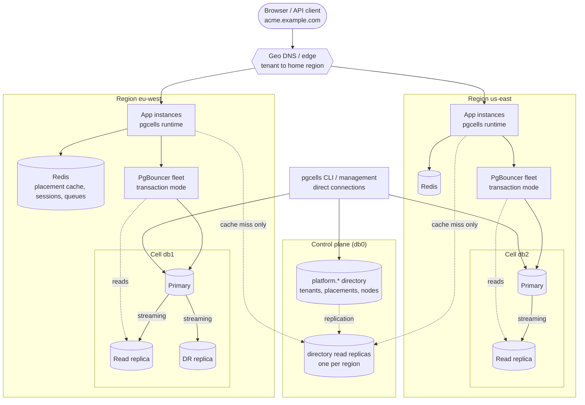
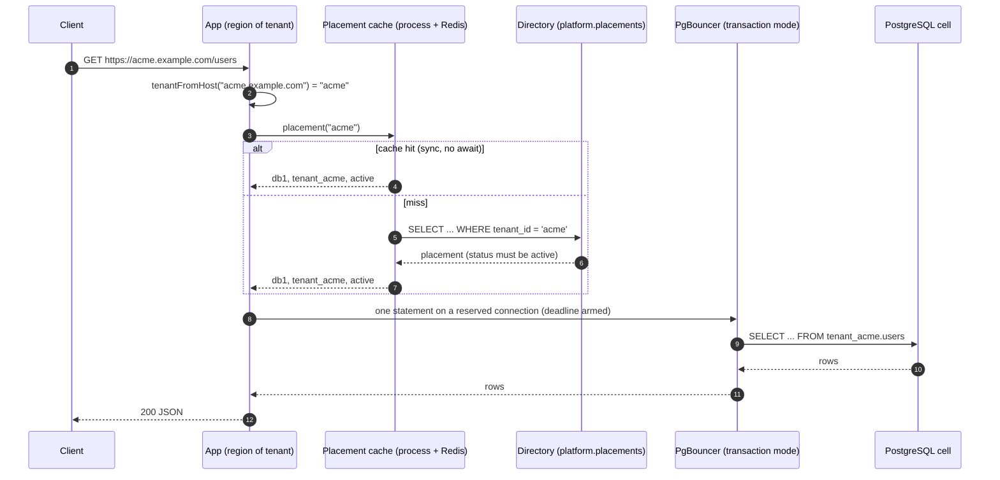
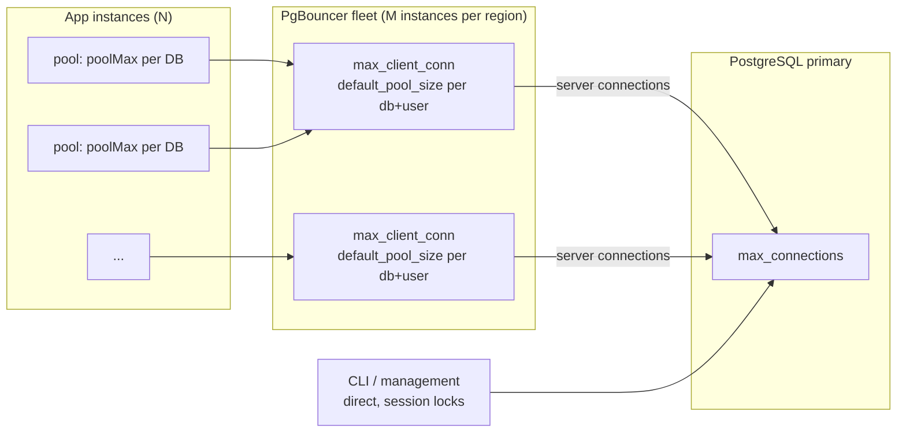
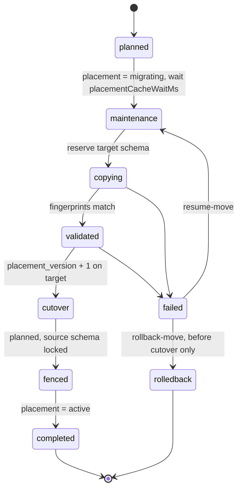

# pgcells

**Region-aware multi-tenant PostgreSQL for TypeScript** — tenants live in *cells* (PostgreSQL clusters), a small directory says where, every connection goes through a transaction pooler, and every statement has a deadline.

[Türkçe](README.tr.md) · [Architecture](#architecture) · [Connection management](docs/guides/connections.md) · [Regions](docs/guides/regions.md) · [Roadmap](docs/design/plans/2026-10-18-roadmap-remaining.md)

> **Status: pre-release.** The engine is complete and heavily tested for a single region. The repository is being renamed and packaged for open source (it was `multi-tenant-example`, packages `@repo/*`); region-aware placement, fencing and connection tooling are planned. See the [design](docs/design/specs/2026-10-18-pgcells-oss-regions-design.md) and the [roadmap](docs/design/plans/2026-10-18-roadmap-remaining.md). Examples below use the target package names.

## Why

Serving thousands of tenants from several regions with a relational database forces a few hard choices. pgcells makes them once, explicitly:

- **One writer per tenant.** A tenant is a schema inside exactly one cell. No cross-region writes, no distributed transactions.
- **A map instead of magic.** `platform.placements` says which cell holds which tenant. It is cached (process + Redis) and never read per request.
- **Connections are a budget.** The app only ever talks to a transaction-mode pooler (PgBouncer, Supavisor, Neon, Hyperdrive). `db.ready()` proves it at startup. Pools are per database, not per tenant.
- **Explicit targets.** Every call names its target (`withTenant`, `withTenantRead`, `withNode`, `withPlatform`). No implicit read routing, no hidden retries, no `search_path`.
- **SQL compiled at build time.** Queries are parsed and schema-qualified by codegen; nothing is parsed at runtime.
- **Operations are first-class.** Migrations across all tenants, provisioning, moves between cells, incremental backups, `doctor`, all idempotent and resumable.

## Packages

| Package | For | Shape |
|---|---|---|
| [`@0furkancolak/pgcells`](packages/db-multi/README.md) | multi-tenant apps | many databases (cells), a schema per tenant, a directory (`db0`) |
| [`@0furkancolak/pgcells-single`](packages/db-single/README.md) | one database, one schema (Neon, Supabase, RDS) | no tenants; same engine, CLI and auth adapter |
| [`@0furkancolak/pgcells-redis`](packages/redis/README.md) | optional | placement cache with cross-process invalidation, auth storage, cache, tenant-aware queues (BullMQ) |

`multi` and `single` are independent copies by design (take the one you need). `redis` depends on `multi`.

## Architecture

### Topology



A **cell** is a PostgreSQL cluster with its pooler fleet. A **tenant** is a schema in one cell. The **directory** (`db0`) maps tenants to cells and stays off the hot path. Today ✅ cells, placement, caching, replicas and offline moves are implemented; region labels, residency checks, directory replicas and fencing are 🔜 planned — the [regions guide](docs/guides/regions.md) has the status table and the failure-mode analysis.

### One request



On a cache hit the placement lookup is a synchronous map read; in the local benchmarks `withTenant` reaches 89–100 % of raw driver throughput (see [performance](packages/db-multi/docs/performance-and-observability.md)). The tenant's schema name is baked into the SQL text from the validated placement; there is no `search_path`.

### Connections



Three layers, three budgets: client connections, pooler server pools, PostgreSQL `max_connections`. The runtime only uses the pooler; management (migrations, provisioning, moves) uses direct connections because it holds session advisory locks. Sizing formulas, a production PgBouncer configuration, timeout alignment and failover behaviour: **[Connection management and PgBouncer](docs/guides/connections.md)**.

### Moving a tenant between cells



Every step is guarded by advisory locks and compare-and-set on `placement_version`, and can be resumed. Moves are currently offline; fencing and zero-downtime moves are planned ([regions guide](docs/guides/regions.md#7-moving-tenants)).

## Quick start

```sh
bun install
cd packages/db-multi
cp .env.example .env && docker compose up -d --wait   # 2 PostgreSQL + PgBouncer locally
bun run cli bootstrap                                 # platform tables, DB identities, timeouts
bun run cli provision acme                            # schema tenant_acme on the least-loaded cell
```

```ts
import { createDatabase } from "@0furkancolak/pgcells";
import { pgDriver } from "@0furkancolak/pgcells/drivers/pg";
import { dbMiddleware } from "@0furkancolak/pgcells/middleware";

const db = createDatabase({ driver: pgDriver });      // reads DATABASE_URLS (pooler URLs); once per process
await db.ready();                                     // proves a transaction pooler, checks DB identities
app.use(dbMiddleware({ database: db, rootDomain: "example.com" }));
app.get("/users/:email", async (c) => c.json(await c.get("db").tenant.query(findUserByEmail, [c.req.param("email")])));
```

`findUserByEmail` is your own query (`src/queries/tenant/users.sql`), compiled by `bun run codegen`. Full walkthrough: [getting started](packages/db-multi/docs/getting-started.md).

## Documentation

- Guides: [Connection management and PgBouncer](docs/guides/connections.md) · [Relational databases across regions](docs/guides/regions.md)
- Reference (`@0furkancolak/pgcells`): [configuration](packages/db-multi/docs/configuration.md) · [tenants](packages/db-multi/docs/tenants.md) · [queries](packages/db-multi/docs/queries.md) · [operations](packages/db-multi/docs/operations.md) · [replicas](packages/db-multi/docs/replicas.md) · [providers](packages/db-multi/docs/providers.md) · [errors](packages/db-multi/docs/errors.md) · [CLI](packages/db-multi/docs/cli.md)
- Design: [specs and plans](docs/design/)

The documentation is in English; the design history in [docs/design](docs/design/) is mostly Turkish.

## Development

```sh
bun run db test              # unit tests of packages/db-multi
bun run single test          # unit tests of packages/db-single
```

Integration and end-to-end suites need Docker: see `packages/db-multi/docs/getting-started.md` and `packages/e2e/docs/running.md`. CI runs type checks, lint, unit and integration tests against PostgreSQL + PgBouncer on three drivers, a Redis suite, and a Workers build.

## Roadmap

Single-region engine ✅ → rename, packaging and fencing (v0.1) → connection tooling (v0.2) → region model (v0.3) → zero-downtime moves and DR (v0.4) → Go implementation of the same contract. Details: [roadmap](docs/design/plans/2026-10-18-roadmap-remaining.md), [Go plan](docs/design/plans/2026-10-18-go-port-plan.md).

## License

Apache-2.0, see [LICENSE](LICENSE). Contributions are welcome: [CONTRIBUTING.md](CONTRIBUTING.md), [SECURITY.md](SECURITY.md).
