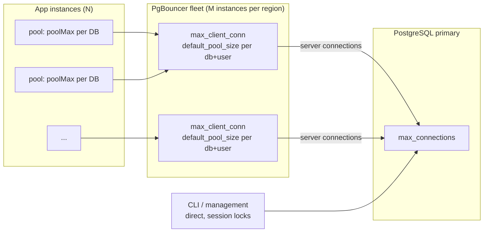

# Connection management and PgBouncer

In a multi-tenant system the database is almost never limited by CPU first. It is limited by **connections**: PostgreSQL forks a process per connection, so a few hundred busy connections cost more than a few thousand queries. This guide explains how pgcells uses connections, how to size every layer, how to run PgBouncer (or any transaction-mode pooler), and what happens when something fails.

Status legend: ✅ shipped today · 🔜 planned (see [the plan](../design/plans/2026-10-18-connections-pgbouncer-plan.md)) · ⚠️ not verified against a real provider. Numbers marked *measured* come from the fault-injection and version tests in `packages/db-multi/src/__tests__/integration` (local Docker, 2026-10-19).

## 1. The mental model: three layers



1. **App → pooler (client connections).** Cheap. A pooler holds thousands. Each app process opens a small pool per database (`poolMax`, default 5) and borrows a connection **per statement or per transaction**.
2. **Pooler → PostgreSQL (server connections).** Expensive. The pooler multiplexes thousands of client connections onto a few dozen server connections, handing one out only for the duration of a transaction (`pool_mode = transaction`).
3. **Management → PostgreSQL (direct).** The CLI and management functions take session-level advisory locks (migrations, provisioning, tenant moves), which a transaction pooler would drop. They connect **directly** (or through session pooling) and never share the runtime path.

The design rule that follows: **the application never talks to PostgreSQL directly at runtime.** `db.ready()` proves this at startup (`POOLER_REQUIRED` otherwise) ✅.

## 2. What the package already does for you ✅

| Behaviour | Where |
|---|---|
| One bounded pool **per database**, not per tenant. 10,000 tenants on a node share one pool. | `createPools` in `core/database.ts` |
| Every statement runs on a reserved connection with a deadline; a connection whose deadline expires is cancelled (if the driver can) and **discarded**, never returned to the pool. | `DeadlineSession` |
| At most 64 waiting operations per database; beyond that `DATABASE_BUSY` immediately (no unbounded queue). | `RUNTIME_MAX_PENDING` |
| Server-side `statement_timeout`, `lock_timeout`, `client_connection_check_interval` are **database defaults** written by `bootstrap`, so they hold behind PgBouncer and Hyperdrive without session `SET`. | `runtimeDatabaseDefaults` |
| No named prepared statements, no session state on the query path. Safe for transaction pooling on all four drivers. | drivers |
| `ready()` detects a direct connection by asking two separately borrowed connections for `pg_backend_pid()`. | `tenants/pooler.ts` |
| Management refuses a pooled URL (`DIRECT_CONNECTION_REQUIRED`). | `operations/locks.ts` |
| `doctor` checks timeouts, identity, the PgBouncer global `pool_mode`, timeout alignment and (given the deployment shape) the connection budget. | `tools/doctor.ts` |

## 3. Sizing: the connection budget

Three inequalities must hold. Write them down for every region.

```
(1) clients:  N_app_instances × poolMax × (1 + replicas_read_through_same_pooler)   ≤  max_client_conn × M_pgbouncer × 0.5
(2) servers:  M_pgbouncer × default_pool_size × distinct(db, user)  +  management  +  maintenance  ≤  max_connections − superuser_reserved − 10 % headroom
(3) flow:     rps_per_node × avg_statement_seconds                                   ≤  default_pool_size × M_pgbouncer   (Little's law)
```

Notes:

- **(1)** keeps rolling deploys from exhausting the pooler: old and new instances overlap, hence the 0.5 factor. Replica pools are separate pools per process: a process holds `poolMax × (1 + replicas)` client connections **per database** ([replicas guide](../../packages/db-multi/docs/replicas.md)).
- **(2)** counts **every** pooler instance: two PgBouncer instances with `default_pool_size = 20` can open 40 server connections to the same database and user. Management is `perDatabaseConcurrency` (default 4) direct connections; add `migrationConcurrency`-driven bursts only while migrating.
- **(3)** is the one people skip. Concurrency needed = arrival rate × latency. A cell serving 5,000 statements/s at 2 ms average needs about 10 busy server connections, not 500. A pool of 20 is plenty; a pool of 200 only adds context switching on PostgreSQL.

**Worked example** (one cell, one region): 40 app instances, `poolMax = 5` → 200 client connections per database; two PgBouncer instances, `max_client_conn = 1000` each (limit 2,000 × 0.5 = 1,000; we use 200: safe for deploy overlap). `default_pool_size = 20` → at most 40 server connections for the application user. The primary has `max_connections = 200`: 40 (app) + 4 (management) + 20 (maintenance, monitoring, replication slots) = 64, well below the limit of 177 (`(200 − 3 reserved) × 0.9`). Throughput ceiling by (3): 40 connections / 2 ms ≈ 20,000 statements/s per cell; 5,000 statements/s at 2 ms needs 10 busy connections.

✅ The same arithmetic is a command, and a unit test locks these exact numbers:

```bash
pgcells pooler plan --instances 40 --pool-max 5 --poolers 2 --default-pool-size 20 \
  --max-client-conn 1000 --max-connections 200 --rps 5000 --latency-ms 2
# {"ok":true,"clients":{"load":200,"limit":1000},"servers":{"load":64,"limit":177,...},"flow":{"needed":10,"available":40,"ceilingRps":20000},"violations":[]}
```

It needs no database and exits 1 on a violation. `doctor --pgbouncer-url --instances 40 --pool-max 5 --poolers 2` runs the same check per node against the pooler's real `max_client_conn`/`default_pool_size` and PostgreSQL's real `max_connections`. In code: `connectionBudget(input)` from `@0furkancolak/pgcells/tools`.

**Pool size on the app side.** Keep `poolMax` small (the default 5 is right for most services): the pooler already multiplexes. Raise it only if `db.acquire` spans show waiting while the pooler's `cl_waiting` is zero. On Cloudflare Workers use `poolMax: 1` per request (sockets cannot outlive a request).

## 4. Topologies

| Topology | Server connections | Latency | When |
|---|---|---|---|
| **Central PgBouncer fleet per region and per cell** behind an L4 load balancer ✅ recommended | `M × default_pool_size` per cell, independent of app instance count | +0.2–0.5 ms | Default for self-hosted and VMs/containers |
| PgBouncer **sidecar per app instance** | `N × default_pool_size` — multiplies with app scale | lowest | Avoid beyond a handful of instances; each sidecar holds its own server pool |
| Managed pooler (Supavisor, Neon pooler, RDS Proxy, Hyperdrive) ⚠️ | managed | varies | Managed PostgreSQL, Workers. Verify with `ready()` / `doctor`; see [providers](../../packages/db-multi/docs/providers.md) |
| PgCat / PgDog | like PgBouncer | like PgBouncer | Possible: transaction mode, multi-threaded. Not tested here |

**PgBouncer is single-threaded.** One process saturates one core, roughly 20–50 k simple queries/s depending on hardware and TLS. Scale **out** with several instances behind the load balancer, or **up** with `so_reuseport = 1` and several processes on one host. Always run at least two for availability.

**Keep the pooler close to the app.** The hot path is app → pooler → primary inside one region. Never route steady-state traffic to a pooler in another region; the only cross-region traffic should be directory reads on a placement-cache miss ([regions guide](regions.md)).

## 5. A production starting point for PgBouncer

The repository ships a development config (`max_client_conn = 200`, `default_pool_size = 10`). For production, start here and measure; values are starting points, not truths. ✅ `pgcells pooler generate` writes this file for your nodes (one alias per node in `DATABASE_URLS`, `dbN_ro1…` per replica in `DATABASE_REPLICA_URLS`), deterministically and without secrets; `--check dir` fails when a deployed `pgbouncer.ini` has drifted. A real PgBouncer loads its output in the integration suite.

```ini
[databases]
; One alias per cell. The app's DATABASE_URLS entry for this cell points at this alias;
; the alias maps to the real database that `bootstrap` configured.
db1 = host=pg1.eu.internal port=5432 dbname=app pool_size=20

[pgbouncer]
; Comments must sit on their own lines: PgBouncer does not strip trailing comments from a value.
; pgcells requires transaction pooling.
pool_mode = transaction
listen_addr = 0.0.0.0
listen_port = 6432
; Several pgbouncer processes on one host.
so_reuseport = 1

; Budget (1).
max_client_conn = 2000
; Budget (2) and (3).
default_pool_size = 20
min_pool_size = 5
reserve_pool_size = 5
reserve_pool_timeout = 3
; Hard cap per database across users.
max_db_connections = 40

; Timeouts: align with the application (section 6). query_wait_timeout > app deadline (statementTimeoutMs + 1 s + 0.5 s).
query_wait_timeout = 8
server_connect_timeout = 5
server_login_retry = 1
client_login_timeout = 10
idle_transaction_timeout = 15
server_idle_timeout = 60
; Recycle server connections; lets failover and credential changes propagate.
server_lifetime = 1800
tcp_keepalive = 1

; Named prepared statements are not used (section 7).
max_prepared_statements = 0

auth_type = scram-sha-256
; Or auth_query for many users.
auth_file = /etc/pgbouncer/userlist.txt
client_tls_sslmode = require
server_tls_sslmode = verify-full

admin_users = pgbouncer_admin
stats_users = pgbouncer_stats
```

With `scram-sha-256` the verifier in `userlist.txt` is also what PgBouncer uses to log in to the servers, so every backend must hold the same verifier for that user (`ALTER ROLE … PASSWORD '<SCRAM-SHA-256$…>'` accepts it), or give per-database credentials in `[databases]`.

Operational commands you will need: `SHOW POOLS` (look at `cl_waiting` and `maxwait`; a persistently non-zero `cl_waiting` means the server pool is the bottleneck), `SHOW STATS`, `SHOW CONFIG`, `RECONNECT` (after `bootstrap` changes database defaults or after a failover), `PAUSE`/`RESUME` (planned maintenance), and a graceful shutdown/online restart so in-flight transactions finish.

⚠️ Parameter names and defaults vary by PgBouncer version; validate against your version's documentation. CI runs the transaction-pooling checks against PgBouncer **1.21.0, 1.23.1 and 1.24.0**, each with `max_prepared_statements` 0 and 100, and found no behavioural difference ([providers.md](../../packages/db-multi/docs/providers.md#pgbouncer-versions)).

## 6. Timeouts must agree

Four clocks apply to one statement. Set them so the **application sees a deterministic error code** instead of an opaque connection reset.

| Clock | Where | Default | Rule |
|---|---|---|---|
| Acquire deadline | app (`statementTimeoutMs`) | 5000 ms | Max wait for a pooled connection; the job never starts when it expires (`DATABASE_TIMEOUT`, class `unreachable`, retryable) |
| Answer deadline | app | `statementTimeoutMs + 1 s` | Statement cancelled, connection discarded, error after at most 0.5 s more |
| `statement_timeout` | PostgreSQL database default, written by `bootstrap` | = `statementTimeoutMs` | **Must equal** the app value, on every cell |
| `query_wait_timeout` | PgBouncer | 120 s (PgBouncer default) | Set **above** the answer deadline (e.g. 8 s for 5 s) so the app's `DATABASE_TIMEOUT` wins; otherwise clients see `08P01` resets. `doctor --pgbouncer-url` checks it (`timeout_alignment`) |

*Measured:* with the application deadline at 2 s a statement that never gets an answer ends with `DATABASE_TIMEOUT` within 3.5 s (`statementTimeoutMs` + 1 s answer margin + 0.5 s cancel wait), through a stalled pooler-to-PostgreSQL leg as well as through added latency; after `RECONNECT` the database-level `statement_timeout` (5 s default) still ends a longer statement at about 5 s on the new server connections.

The `client_connection_check_interval = 1000` database default makes PostgreSQL stop a running statement within a second after the client disappears, which is what makes "discard the connection" safe even for drivers that cannot cancel (Bun SQL, Neon).

## 7. What you cannot do through a transaction pooler

| Feature | Why it breaks | What to do |
|---|---|---|
| Session advisory locks (`pg_advisory_lock`) | The lock belongs to a server connection that the pooler hands to someone else | Use transaction locks (`pg_advisory_xact_lock`); management uses direct connections |
| `LISTEN` / `NOTIFY` | Needs one stable session | Use a direct connection for listeners, or Redis pub/sub |
| Session `SET` / `RESET` | Leaks to the next client | `SET LOCAL` inside a transaction |
| Temporary tables, `WITH HOLD` cursors, `DECLARE` outside a transaction | Session scoped | Avoid; use transaction scope |
| Named prepared statements | Server connection differs per transaction | Not used, and **not planned** (decided 2026-10-19). PgBouncer ≥ 1.21 can track them with `max_prepared_statements > 0`, but the SQL text carries the tenant schema, so the statement count is queries × tenants: in a spike with 20,000 distinct statements postgres.js gained nothing and its client-side cache grew by about 27 MB per run ([measurements](../../packages/db-multi/docs/performance-and-observability.md#decision-named-prepared-statements-rejected)) |
| `COPY` through the app path | Driver/pooler dependent | Use management (direct) for bulk operations |

The package enforces what it can: the query compiler never emits session state, the runtime has no `LISTEN`, and management is direct-only.

## 8. Deploys, restarts and failover

| Event | What the application sees | What to do |
|---|---|---|
| App rolling deploy | Old and new pools overlap | Budget (1) with the 0.5 factor. ✅ `await db.close({ drain: true, timeoutMs })` refuses new work (`ready()` fails at once, so the load balancer drains), waits for the contexts that already started, then closes the pools; `dbMiddleware(...).shutdown()` does it for the shared database. *Measured:* with six request loops running, switching to a new generation and draining the old one failed no request |
| PgBouncer restart | Requests fail until the pooler is back; e2e scenario 10 measures recovery ✅. *Measured* (pooler stopped behind a TCP proxy, `statementTimeoutMs` 2 s): each request fails after the acquire deadline (2.0 s) with `DATABASE_TIMEOUT` that classifies as `unreachable` and is retryable, because nothing was sent; the first request after the pooler is back succeeds within a second (141 and 877 ms in two runs) | Run ≥ 2 poolers behind a load balancer; use online restart / `so_reuseport` handover |
| `bootstrap` changed timeouts | Existing server connections keep old values | `RECONNECT` on the pooler; `doctor` reports `runtime_timeouts` |
| PostgreSQL primary failover (managed) | `DATABASE_UNAVAILABLE` (503) or `DATABASE_TIMEOUT` (504) for that cell for tens of seconds; other cells unaffected (e2e scenario 8 ✅). *Measured* (pooler-to-PostgreSQL leg cut): the first request ends with `DATABASE_TIMEOUT` after `statementTimeoutMs` + 1.5 s (3.5 s at 2 s); PgBouncer then caches the failed login for `server_login_retry` and answers later requests at once with `08P01` (`pooler-reset`, retryable); the leg is usable again within a second of healing (255 ms in the run). A partition that stalls data without closing connections ends the same way, bounded by the same 3.5 s | Point the pooler at the cluster's stable endpoint/DNS; short `dns_max_ttl`; `RECONNECT` if the endpoint pins an IP |
| PostgreSQL cell down | Only that cell's tenants fail; `ready()` fails, so the load balancer drains the instance | Health endpoint should call `ready()`, not the request path |
| Hyperdrive / managed pooler | Provider-specific | ⚠️ not verified; use `pooler: "assumed"` after checking the provider docs |

There are **no hidden retries**. After a failover the application gets an error and decides. ✅ `failoverClass(error)` and `retryable(error)` (`@0furkancolak/pgcells`) classify errors so callers can retry **idempotent** work deliberately:

| Class | Examples | `retryable` |
|---|---|---|
| `connection-reset` | `ECONNRESET`, closed connection, `08006`, `08003` | yes (the statement may or may not have run) |
| `unreachable` | `ECONNREFUSED`, `ETIMEDOUT`, `ENOTFOUND`, `08001`, `DATABASE_TIMEOUT` before the statement was sent (no connection within the deadline) | yes |
| `admin-shutdown` | `57P01`, `57P02`, `57P03` | yes |
| `read-only` | `25006` (a write reached a demoted primary) | yes |
| `pooler-reset` | `08P01` | yes |
| `busy` | `DATABASE_BUSY`, `53300` | yes, after a backoff |
| `timeout` | `DATABASE_TIMEOUT` while the statement was running, `57014` | **no**: it may have committed |

Everything else (a constraint violation, a missing table, an unknown tenant) is not a failover error. `retryable` says a retry is *possible*; whether it is *safe* depends on your work being idempotent.

## 9. Fairness: one tenant must not starve the rest

The pool is per database, so a noisy tenant can occupy all server connections of its cell. Today the protection is capacity planning (placement `size` and node `capacity`) and the 64-waiter bound. ✅ A per-tenant limit (`tenantMaxInflight`, default off) fails fast with `DATABASE_BUSY` for the offender while others proceed. It counts concurrent *contexts* (`withTenant`, `withTenantRead`, request scopes) per tenant in the process; with it off nothing is counted per tenant. *Measured* under a storm of 320 concurrent statements from 4 processes with `poolMax` 5 against a server pool of 5: each process shed load with `DATABASE_BUSY` beyond its 64 pending jobs, the pooler queued the rest (`cl_waiting` > 0), and every accepted statement completed. Move a persistently noisy tenant to a dedicated cell ([tenant moves](regions.md#7-moving-tenants)).

## 10. Monitoring checklist

- Spans ✅: `db.acquire` (waiting for a connection), `db.query`, `db.transaction`, `placement.read` vs `placement.cache` ([telemetry](../../packages/db-multi/docs/telemetry.md)). A rising `db.acquire` with idle PostgreSQL means the pool or pooler is the bottleneck.
- PgBouncer: `cl_waiting`, `maxwait`, `sv_active`, `sv_idle`, `avg_query_time`, `total_wait_time`.
- PostgreSQL: `pg_stat_activity` grouped by `state` and `application_name`, `idle in transaction` count, `max_connections` utilisation.
- ✅ `db.stats()` exposes pool in-use, waiting, acquisition-time percentiles, discarded connections and refused jobs per database without a tracing backend; `poolGauges(db, meter)` publishes them to OpenTelemetry ([telemetry](../../packages/db-multi/docs/telemetry.md)). Driver pools do not expose idle counts uniformly, so there is no `idle` figure; use PgBouncer's `sv_idle`.

## 11. Serverless and edge

Workers cannot keep sockets across requests: create the pool per request with `poolMax: 1` and close it with `ctx.waitUntil(db.close())`. Use a provider pooler (Hyperdrive with caching **disabled**, Neon pooler with the `neonDriver`, Supavisor transaction mode). Placement lookups must come from a regional Redis/KV cache, otherwise every request reads the directory ([regions guide](regions.md)).

## 12. Checklist before production

- [ ] `DATABASE_URLS` points to poolers; management uses direct URLs from a separate environment.
- [ ] Budget inequalities (1)–(3) written down per cell, with current numbers.
- [ ] `bootstrap` run; `doctor` is green, including `runtime_timeouts` and `pooled_runtime`.
- [ ] Application `statementTimeoutMs` equals the database default; `query_wait_timeout` is above the answer deadline.
- [ ] ≥ 2 PgBouncer instances per cell, behind an L4 load balancer.
- [ ] `/ready` calls `db.ready()`; liveness does not.
- [ ] Alerting on `cl_waiting`/`maxwait`, `db.acquire` p99, `DATABASE_BUSY` rate.
- [ ] Failover drill performed once, results recorded.
