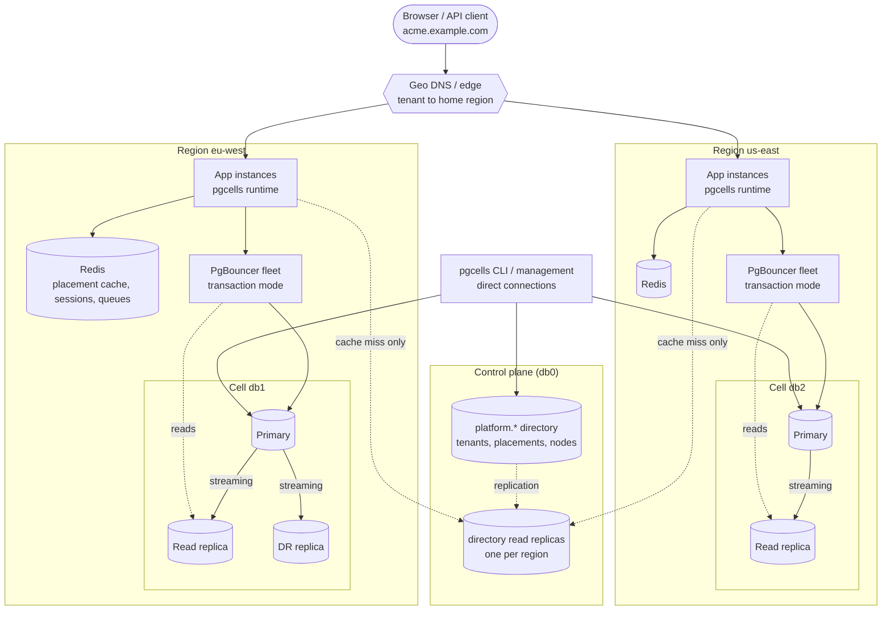
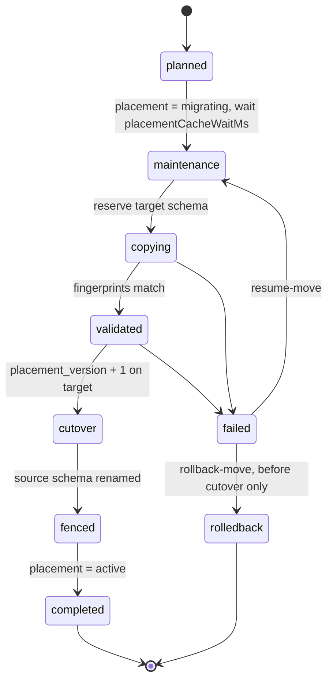

# Using a relational database in a multi-region system

How should PostgreSQL be used when a product serves customers in several regions, must keep some data in a region, and has thousands of tenants? This guide gives the reasoning behind pgcells' answer — **cells with a single writer, a small directory, local reads** — and says honestly which parts exist today.

Status legend: ✅ shipped today · 🔜 planned (see [the plan](../design/plans/2026-10-18-regions-plan.md)) · ⚠️ not verified against a real provider.

## 1. Why not one global database

| Problem | Why it hurts |
|---|---|
| **Latency** | A cross-region round trip is 70–200 ms. A request doing five sequential queries pays it five times. |
| **Write bottleneck** | One primary is one writer; vertical scaling ends. |
| **Blast radius** | One bad migration, one failover, one noisy tenant affects everyone, everywhere. |
| **Residency** | "EU data stays in the EU" cannot be promised with one primary. |
| **Operations** | A 4 TB database is slow to back up, restore, upgrade or move. |

The remedy is not a cleverer global database; it is **many small databases, each close to the people who use it, plus a map that says which tenant lives where.**

## 2. Choosing a tenancy model

| Model | Isolation | Moving a tenant | Ops cost | Fits when |
|---|---|---|---|---|
| Shared tables + `tenant_id` (+ RLS) | Logical, easy to get wrong | Hard (rows are interleaved) | Lowest | Millions of tiny tenants, no residency |
| **Schema per tenant, grouped in cells (pgcells)** | Strong (own tables, own migrations state, no cross-tenant joins) | Per-schema copy: simple | Medium: catalogs grow, migrations run per tenant | Hundreds to a few thousand tenants per cell, tens of tables each |
| Database per tenant | Strongest | Easy | Highest: connections and upgrades per tenant | Few, large tenants; compliance demands |
| Distributed SQL (CockroachDB, Spanner, Yugabyte, Citus) | Logical | Automatic | A different system to run | You need cross-tenant transactions or global writes |

pgcells is the second row. It does **not** try to be the others: schema-per-tenant is the wrong tool for millions of tiny tenants (catalog bloat) and for cross-tenant analytics (use a warehouse fed from the cells).

## 3. The cell architecture

- A **cell** is one PostgreSQL cluster (primary, local read replicas, a DR replica) with the pooler fleet in front. In pgcells terms a cell is a **node** (`db0`, `db1`, …) ✅.
- A **tenant** is a schema (`tenant_acme`) inside exactly one cell. It has one writer, ever. ✅
- A cell holds many tenants, bounded by `capacity` (sum of tenant `size`) and can be set to `draining` ✅.
- Cells are independent failure domains: a cell outage affects only its tenants (verified in the e2e suite: scenario 8 ✅).

## 4. The control plane: a small directory, off the hot path

The directory (`platform.placements`, `platform.nodes`, `platform.tenants`) answers one question: *where does tenant X live?* It is tiny and changes rarely, so it is **cached aggressively and never queried per request**:

1. in-process cache (default 5 s, hard limit 25 s) ✅
2. regional Redis cache with pub/sub invalidation (`@0furkancolak/pgcells-redis`) ✅ — pub/sub may drop messages; correctness never depends on it, only the TTL does
3. the directory itself, only on a miss ✅

The staleness bound matters because moves rely on it: after a move marks the placement `migrating`, the mover waits `placementCacheWaitMs` (30 s) so that no process can still hold the old `active` record ✅.

**Making the directory survive regions** ✅. The directory lives on `db0` in one region. If that region is unreachable, cached tenants keep working for the cache TTL, then (with `staleIfErrorMs` set) for the stale window you chose, and then placement reads fail. What exists:

- A physical read replica of `db0` in each region, configured through the existing `DATABASE_REPLICA_URLS` mechanism (`db0=…`). Directory reads for `active` placements use it; anything not `active` or not found is confirmed on the primary ✅.
- Because replica lag adds to staleness, `placementCacheWaitMs` must be at least `PLACEMENT_CACHE_MAX_MS + replicaMaxLagMs`; `createManagement` enforces it (`INVALID_CONFIG`) ✅.
- **Stale-if-error** (`staleIfErrorMs`, off by default, at most 5 minutes): when the directory is unreachable, an expired `active` placement is served for a bounded extra time. It is safe because of *fencing* (section 7): a process that is stale anyway cannot write to a moved tenant's old copy ✅. `migrating` and `maintenance` records are never cached, so they are never served stale.
- Writes to the directory (create tenants, move tenants, register nodes) go to the `db0` primary only. While `db0` is down a remote region cannot create or move tenants; serving existing tenants continues. `db0` failover is the database provider's job; pgcells does not promote.

Keep personal data out of the directory 🔜: `platform.tenants` may carry application columns (for example `owner_email`). They are allowed, but `doctor` warns, because the directory lives in one region.

## 5. Routing a request to the right region

pgcells resolves *which cell*; getting the request to the right **region** is the edge's job:

- Give each tenant a hostname (`acme.example.com`). Geo-DNS or an edge router maps it to the tenant's `home_region` 🔜 (today you maintain that mapping yourself).
- If a request still reaches the wrong region, the safe default is to **fail**, not to silently talk to a cell across an ocean. 🔜 `createDatabase({ region: "eu-west" })` plus the `regionGuard` middleware responds `421` (or `307` to the right host, by option) and calls `onWrongRegion`. Without `region`, nothing changes (single-region mode).
- Application-level caches, queues and sessions are **per region** too (Redis per region). Never share them across regions: it breaks residency and adds latency.

## 6. Consistency model

| Scenario | Guarantee |
|---|---|
| Read after write **in the same request** | Reads go to the primary after a write in that request ✅ |
| Reads in the same request | Pinned to the same replica (monotonic) ✅ |
| Next request, same region, read from replica | Stale by replica lag (default limit 5 s) ✅ |
| Next request needing your own write | Read from the primary (`tenant` context), or 🔜 pass a *causal token* (write returns the primary's LSN; the replica read waits until it has replayed that LSN or falls back to the primary) |
| Across regions | Not applicable: a tenant has one home. There is no cross-region replication of tenant data except the DR replica (section 9) |
| Replica too far behind | Falls back to the primary in a `READ ONLY` transaction, or errors, by policy ✅ |

No hidden retries and no implicit read routing: the target (primary or replica) is explicit at every call. That is a deliberate property of the API.

## 7. Moving tenants

Reasons: rebalancing, a noisy tenant, a customer relocating to another region, retiring a cell.

Today ✅ the move is correct but **offline**: the tenant is unavailable from `maintenance` until `completed`, and rows travel as JSON batches through the operator's process. It is verified for small tenants (e2e: 3.5 k rows, 30.7 s of which 30 s is the safety wait); no measurement for large tenants exists yet, so plan for hours at the gigabyte scale.

**Fencing** ✅. The safety wait bounds how stale a cached placement can be, but nothing on the *data path* stops a process that is stale anyway (long pause, partitioned from Redis, custom placement source) from writing to the old copy after cutover; the write would succeed and be lost. After cutover the mover therefore **renames the source schema** (`tenant_acme` → `tenant_acme__moved_<id>`): a stale writer fails with `undefined_table` instead of silently writing. Rename (not `REVOKE`) because runtime and management share a role and because it works on every provider. It costs nothing on the hot path (no per-query version check). The renamed copy stays inspectable; moving back is a normal new move, and `doctor` lists the copies (`retained_moved_copies`) and warns about old ones that kept the tenant's own name (`unfenced_moved_copies`).

**Zero-downtime move** 🔜 (later): initial snapshot + logical replication catch-up, then a write pause of seconds for the cutover. Targets: plain PostgreSQL 16, a tenant up to 50 GB, pause ≤ 5 s. Provider support depends on `wal_level = logical`, primary keys (or `REPLICA IDENTITY FULL`), and sequence sync at cutover ⚠️; the support matrix will say "supported / restricted / unsupported" per provider.

**Cross-region moves** require an explicit flag (`--allow-cross-region`) and must satisfy the tenant's residency zone (section 8).

## 8. Residency

🔜 Nodes carry a `region` and a `residency_zone` (for example `eu`). A tenant carries a `residency_zone` (empty = unrestricted). `provision`, `restore`, `move` and `adopt` reject a target outside the zone (`RESIDENCY_VIOLATION`) in the same SQL transaction that writes the placement.

What this guarantees: **the package never places or moves tenant data outside its zone.** What it cannot guarantee, and the documentation says so: the application columns you add to the directory (`owner_email`), where you write backups, your logs, your analytics pipeline, your Redis. `doctor` warns about the ones it can see.

A short checklist for regulated deployments:

- Per-region Redis, queues, object storage, log sinks.
- Backups of a cell stay in that region (or its zone); the DR replica lives in the same zone.
- Directory holds no personal data, or you accept that the directory's region holds it.
- Support tooling reads through the app, not across regions.

## 9. Replicas: read scaling versus disaster recovery

| | Read replica | DR replica |
|---|---|---|
| Purpose | Take read load off the primary | Survive loss of the primary (or its region/zone) |
| Where | Same region, same zone | Another availability zone or region **inside the same residency zone** |
| Used by the app | Yes, explicit `tenantRead` ✅ | No, except after promotion |
| Failure policy | Fall back to the primary or error ✅ | Promote, then repoint the cell's pooler 🔜 runbook and `doctor` checks |

Replica selection is round-robin among healthy, caught-up replicas ✅; 🔜 each replica gets a `region` so the router prefers local ones and never mixes continents. Cell failover = promote the DR replica and point the pooler's database alias at it; because the application connects to the **pooler** (stable name), no application change is needed. Position-based node identity (`DATABASE_URLS[i]` = `db<i>`) is verified against `platform.node_identity` after failover ✅.

## 10. Failure modes: what happens today and the target

| Failure | Today | Target |
|---|---|---|
| A cell's primary is down | Only that cell's tenants fail (`DATABASE_UNAVAILABLE`/`DATABASE_TIMEOUT` within ~7 s); others are fine ✅ (e2e 8) | Same, plus documented promote-DR runbook 🔜 |
| Pooler fleet down | Same as cell down for that region ✅ | ≥ 2 poolers per cell, documented; failover drill in CI-style test 🔜 |
| Redis down | Falls back to process cache then directory; sessions fail open ✅ (e2e 10) | Same |
| `db0` / directory unreachable | Cached tenants work for the cache TTL (5–25 s) plus `staleIfErrorMs` (if set), then placement reads fail for everyone; no provisioning or moves ✅ | Same; a replica of `db0` in each region answers `active` lookups meanwhile ✅ |
| Whole region down | Its tenants are unavailable; other regions fine **if** they can still reach the directory (a directory replica or `staleIfErrorMs` covers it) ✅ | DR promotion in the zone 🔜 |
| Stale placement after a move | Bounded by TTL + wait, and a stale writer fails with `undefined_table` after cutover (fencing) ✅ | Same |
| Wrong-region request | Works, slowly, across regions | `421`/`307` or hook 🔜 |

## 11. Capacity and noisy neighbours

- Give each tenant a `size` (1–100, a relative load estimate) and each cell a `capacity` (default 1000); placement picks the active cell with the lowest `(load + size) / capacity` ✅.
- Schema-per-tenant puts every tenant's tables in one catalog. Rule of thumb: stay in the hundreds to low thousands of tenants per cell and tens of tables each; watch catalog size, autovacuum and migration time. When a cell is full, **add a cell** (append to `DATABASE_URLS`, `bootstrap`) rather than growing it.
- A tenant that dominates its cell should move to a dedicated cell 🔜 (`pin`/labels so automatic placement never co-locates others).
- Per-tenant in-flight limits 🔜 (see [connections](connections.md#9-fairness-one-tenant-must-not-starve-the-rest)).

## 12. Anti-patterns

- Joining across tenants or regions in the request path. Feed a warehouse instead.
- Global sequences or unique constraints across tenants; use UUIDs and per-tenant uniqueness.
- Synchronous cross-region writes "for safety". They add latency without removing the single-writer rule.
- Letting application servers connect to a database in another region in steady state.
- Sharing Redis, queues or sessions across regions.
- Treating the directory as a transactional dependency of every request.
- Relying on pub/sub invalidation for correctness; only TTLs are a guarantee.

## 13. Status

| Capability | Status |
|---|---|
| Cells, placement, capacity-aware choice, draining | ✅ |
| TTL-bounded cache + Redis invalidation, CAS on `placement_version`, locks | ✅ |
| Replica reads with lag guard, request-scoped read-your-writes | ✅ |
| Offline move, backup/restore, adopt | ✅ |
| Node `region`/labels/`residency_zone`, tenant `home_region`, residency checks | 🔜 |
| `regionGuard` / `onWrongRegion`, `createDatabase({ region })` | 🔜 |
| Replica locality | 🔜 |
| Fencing at cutover | ✅ |
| Directory replicas, stale-if-error | ✅ |
| Causal read tokens | 🔜 |
| Zero-downtime move, DR promote runbook | 🔜 |
| Multi-region behaviour on real providers/networks | ⚠️ |
